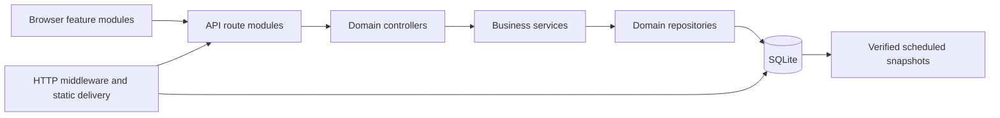

# Architecture

## Request flow

API endpoints use route -> controller -> service -> repository boundaries. `server.js` contains HTTP orchestration, shared middleware, safe static delivery and background maintenance. Auth, visits, owner operations, shortlists, listings, matching and the rent tools (affordability, commute, neighbourhoods, comparison, price insight) each have separate route, controller and service modules. The browser keeps no business rules: `public/js/` modules render API responses.

## Relational model and reliability

`users` stores account identity and salted scrypt hashes. `properties.owner_id` references users. `visits` references properties. `shortlists` joins users and properties with a composite key. `sessions` stores a SHA-256 digest of the random browser token, user id and expiry. `rate_limits` stores hashed IP/route buckets so login throttling survives process restarts and is shared by processes using the same SQLite database. `audit_log` is an append-only record of registrations, successful and failed logins, property claims and visit status changes (no passwords or tokens). `idx_visits_active_slot` is a partial unique index over `(property_id, visit_date, visit_time)` for REQUESTED/CONFIRMED visits, so the database itself rejects double bookings. Listing claims use a single atomic `UPDATE ... WHERE owner_id IS NULL`. `password_resets` holds hashed single-use reset tokens. `properties.lat/lng` support distance search. `schema_migrations` records versions 1-6, mirrored with SQLite `user_version`.

SQLite enables foreign keys, WAL and busy timeout. Seed inserts use a transaction. Constraints, unique email, indexes and foreign keys protect relationships. `VACUUM INTO` makes a consistent backup, then `quick_check` verifies it. Restore validates the backup and preserves the active DB before replacing it. Stop the server before restore.

## Matching weights

- Budget: 35 points at/below budget; 15 up to 10% over; otherwise 0.
- BHK: 25 exact, 12 one bedroom away, otherwise 0.
- Location substring match: 20.
- Pet suitability: 10 when requested and available; if not requested, neutral/full points.
- Parking: 10 when requested and available; if not requested, neutral/full points.

Scores total 100. Results sort by score descending, then rent ascending; up to five matches include reasons. This is a deterministic demo ranking, not a learned model or suitability guarantee.

## Price insight

`GET /api/properties/:id/insight` divides rent by size, compares it with the median rent per sq.ft. of sample listings in the same city, and labels the listing `BELOW_MARKET` or `ABOVE_MARKET` when it differs by more than 10%, otherwise `FAIR`. It is a transparent comparison of sample data, not a valuation.

## Concurrency model

SQLite runs in WAL mode with `busy_timeout=5000`, so readers do not block the writer and competing writers wait instead of failing. Races are resolved by the database, not by application checks: one winner for a listing claim, one winner per visit slot, idempotent shortlist inserts (`INSERT OR IGNORE` on a composite key) and an upsert with `RETURNING` for rate-limit counters. `tests/concurrency.test.js` starts six separate processes against one database file and asserts no errors, exactly one claim winner, one booking per contested slot, no duplicate rows and clean `integrity_check` and `foreign_key_check` results. The limit is architectural: it is one file on one host. Moving to PostgreSQL would be the next step for multi-host scaling.

## Deployment view

See the diagram in README.md and DEPLOYMENT.md: optional TLS edge (Caddy/platform) -> Node server -> SQLite volume, with verified backups on a second volume. Nearby search computes haversine distance in `services/nearbyService.js` over rows from the repository; the browser (`public/js/mapSearch.js`) only draws the map and results.
