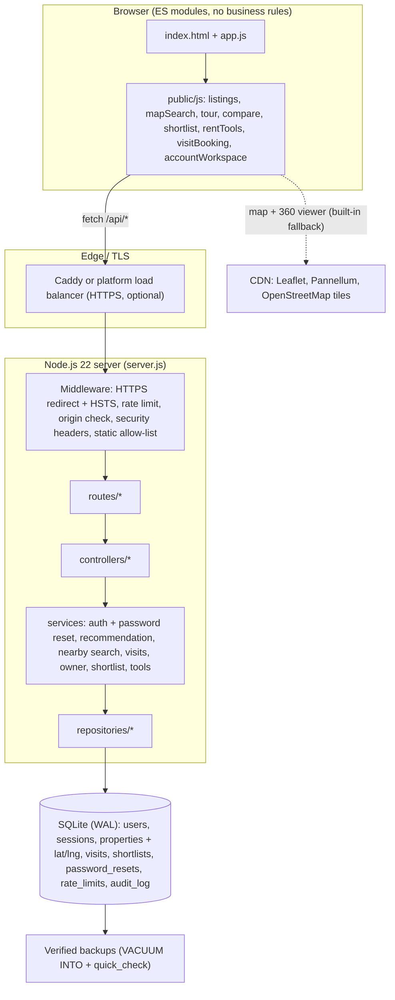

# NestNavigator - RentRight

A responsive rental discovery and visit-management app using browser JavaScript, Node.js and SQLite. The existing design and features are retained: listings, sample 360 tour, calculators, comparison, shortlist, visit scheduling, owner workspace and sample lease preview.

## Clean installation

Requirements: Node.js 22.5+ (built-in `node:sqlite`), npm and a modern browser. There are no runtime npm dependencies.

1. Extract the ZIP and open a terminal in the project directory.
2. Run `npm start` (or `node --env-file=.env server.js` after copying `.env.example` to `.env`).
3. Open `http://localhost:3000`.

The database schema and 12 sample listings are created on first start. Opening `index.html` with `file://` will not connect to the API. Node does not automatically load `.env`; export variables in the shell or use `--env-file`.

## Tests and database tools

- `npm test`: 59 automated tests (including password recovery, SMTP client, nearby search, TLS/HTTPS-redirect and OpenAPI route-coverage tests): validation, backup, route-by-route API integration tests written with a Supertest-style helper (`tests/helpers/request.js`, same `request(server).get().set().send().expect()` API), server-side tools, audit log, static-file protection, a fake-DOM test of the browser entry point and a multi-process concurrency test. Each uses a temporary SQLite database.
- `npm run check`: syntax checks and tests.
- `npx playwright install chromium` then `npm run test:e2e`: browser test for filtering, matches, visits, shortlist and owner workflow (not run in CI here).
- `npm run db:backup`: create and verify a one-time SQLite snapshot.
- `npm run db:restore -- path/to/backup.sqlite`: verify, preserve the current DB, then restore. Stop the server first.

While running, the app creates a consistent verified backup every 24 hours and retains seven. Set `BACKUP_INTERVAL_MS`, `BACKUP_KEEP`, `BACKUP_DIR`, `RATE_LIMIT_PER_MINUTE` and `LOGIN_RATE_LIMIT_PER_MINUTE`. Copy backups off-host for disaster recovery.

## Architecture and documentation

`routes/`, `controllers/`, `services/`, and `repositories/` separate authentication, visits, owner operations, shortlists, listings and recommendations. `server.js` handles HTTP orchestration, shared middleware, safe static delivery and background maintenance. Browser features are split into `public/js/` modules (store, listings, shortlist, compare, tour/details, lease, rent tools, matching, booking, account workspace); `app.js` only wires them together. Listings are filtered and sorted by the API, and the shortlist, comparison, move-in/affordability calculator, commute estimate, neighbourhood scores and price insight are all computed or stored server-side. See [ARCHITECTURE.md](ARCHITECTURE.md), [API.md](API.md) and the machine-readable [openapi.yaml](openapi.yaml), [SECURITY.md](SECURITY.md) and [EVALUATION_IMPROVEMENTS.md](EVALUATION_IMPROVEMENTS.md).

## Architecture diagram

Request path: browser module -> (optional TLS proxy) -> middleware -> route -> controller -> service -> repository -> SQLite. Business rules (matching, affordability, nearby search, price insight, password reset) live in services; the browser only renders API responses.

## Deployment and HTTPS

`docker compose up --build` runs the app in a non-root container with health check and persistent volumes. `docker-compose.https.yml` adds Caddy for automatic Let's Encrypt HTTPS, `render.yaml` is a Render blueprint, and the app itself can terminate TLS (`TLS_KEY_FILE`/`TLS_CERT_FILE`) or sit behind a proxy (`TRUST_PROXY`, `FORCE_HTTPS`: redirect, HSTS, Secure cookies). Full instructions: [DEPLOYMENT.md](DEPLOYMENT.md). The Docker and Render files were written but not executed in the environment where this revision was prepared (no Docker daemon); the TLS and redirect behaviour is covered by automated tests.

The 360° tour uses Pannellum (WebGL, loaded from a CDN) with a self-hosted, procedurally generated sample room (`public/assets/sample-room-360.jpg`, generator in `scripts/`). If Pannellum cannot load or WebGL is unavailable, `public/js/panoViewer.js` (a small built-in canvas viewer: drag, zoom buttons, arrow keys) takes over automatically. Replace the image with real owner-captured panoramas for production.

## Map-based search and password recovery

- **Map search** (`#mapSearch`): choose a landmark or click the map, set a radius; `GET /api/properties/nearby?lat&lng&radiusKm` returns homes within that circle sorted by haversine distance (listings have approximate `lat`/`lng`, schema migration 6). Leaflet and OpenStreetMap tiles load from a CDN; if they cannot load, landmark/radius search and the result list still work.
- **Password reset**: `POST /api/auth/forgot-password` (same response for any email) and `POST /api/auth/reset-password`. Tokens are 256-bit random values, stored only as SHA-256 digests, valid for 30 minutes and single use; a successful reset signs the account out everywhere. The link uses a URL fragment (`/#reset=<token>`) so the token is not sent in request lines. Mail goes through `lib/mailer.js`: real SMTP delivery when `SMTP_HOST` is configured (built-in client, `lib/smtp.js`), console output otherwise (see DEPLOYMENT.md).

## Continuous integration

`.github/workflows/ci.yml` runs `npm run check` on Node 22 and 24, the Playwright journey and a Docker build with a health-check smoke test on every push. These workflows have not been executed in the environment where this revision was prepared (no GitHub runner).

## Recommendation score

100 points: budget 35 (15 if up to 10% over), BHK 25 (12 if one bedroom away), location 20, pets 10 and parking 10. Unrequested pet/parking criteria are neutral and score full points. Top five sort by score then rent; each result includes reasons. It is a transparent demo rule, not an ML model.

## Honest limitations

Attempt 2 scored 64/100. This revision addresses the cited gaps (authentication, relational database, owner visit management, API tests, separated layers, server-side business logic, audit log), but no score is guaranteed. Signed-out visitors cannot save homes: the shortlist is stored per user in SQLite (there is no localStorage fallback). Sample listings, owner claiming, commute times, neighbourhood scores, price insight and the panorama are illustrative. The Playwright test covers one user journey and was not executed in the environment where this revision was prepared; the Node tests were. Concurrency is handled by SQLite WAL, a 5-second busy timeout, atomic claim statements and a unique index on live visit slots; it is proven across six OS processes sharing one file, but it is still a single-host database (not PostgreSQL), and `supertest` itself is not installed (the helper mirrors its API). Rate limits are stored in SQLite and shared by processes using that database; multi-host deployments should move them to a dedicated shared store. There is still no email verification, owner verification, verified delivery through a real mail provider (the SMTP client is tested only against fake servers; without `SMTP_HOST` reset mail is printed to the console), offline map tiles or formal security review. Listing coordinates are approximate neighbourhood centres. Deploy with HTTPS (see DEPLOYMENT.md).
